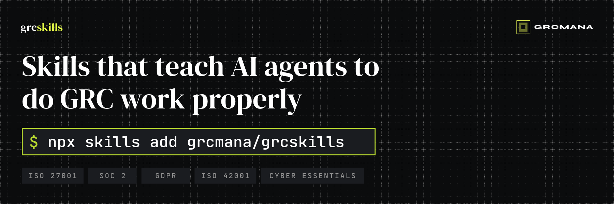

<p align="center">
  
</p>

# GRC Skills for AI Agents

[](https://github.com/grcmana/grcskills/releases)
[](https://github.com/grcmana/grcskills/actions/workflows/validate.yml)
[](LICENSE)

A collection of AI agent skills for governance, risk and compliance work. It's built for two kinds of people:

- **GRC practitioners and engineers** who want their agent to take on the repetitive parts of running a programme.
- **"Accidental" owners**: the founder, CTO or ops lead who has just been told a customer needs ISO 27001, SOC 2 or Cyber Essentials.

The skills cover company context, risk registers, AI impact assessments, policies, audit readiness, evidence and DPIAs across **ISO 27001, SOC 2, Cyber Essentials, GDPR and ISO 42001**. They work with Claude Code, OpenAI Codex, Cursor and any agent that supports the [Agent Skills spec](https://agentskills.io).

Built by **Harry West**, founder of [GRCMANA](https://grcmana.com). Harry has spent around 20 years in cybersecurity, including Global CISO roles. He is GRCP certified and a Certified Lead Implementer for ISO 27001, ISO 27701 and ISO 42001. These skills encode how he runs GRC programmes in practice: start from the business's real context, write controls an auditor can test, and keep a human accountable for every decision.

- **New skills and framework updates:** subscribe at [grcskills.io](https://grcskills.io).
- **The full workspace:** [GRC OS](https://github.com/grcmana/grc-os) bundles every skill with operating instructions, guardrails and a worked example.
- **Contributions welcome.** Found a way to improve a skill, or spotted a framework error? [Open a PR](#contributing) or [an issue](https://github.com/grcmana/grcskills/issues/new/choose).

> [!IMPORTANT]
> Skills produce **drafts for review by a competent person**. They don't certify compliance, replace an auditor or give legal advice. See the [disclaimer](#disclaimer).

## What are skills?

Skills are folders of instructions, reference knowledge and templates that give an AI agent the expertise for a specific task. Once they're installed in your project, your agent recognises when you're doing GRC work and follows the right method, without you having to explain ISO 27001 clause 6.1.2 or how a SOC 2 auditor samples evidence.

Each GRC skill carries the framework knowledge it needs: own-words summaries with clause and control IDs, and an `as_of` date so you know when to check the official source. Everything the skills produce is plain Markdown and CSV in a `grc/` folder you control.

## How skills work together

`company-context` is the foundation. Every other skill reads the company profile it creates (what you sell, the data you hold, your tech stack, who's asking for what), so the output is about your organisation, not a generic one. `grc-status` sits at the other end and rolls everything up for leadership.

```
                         ┌────────────────────────────────────────┐
                         │            company-context             │
                         │   (profile, scope, frameworks — read   │
                         │        by every other skill first)     │
                         └───────────────────┬────────────────────┘
                                             │
           ┌───────────────────────┬─────────┴─────────────┬───────────────────────┐
           ▼                       ▼                       ▼                       ▼
┌─────────────────────┐ ┌─────────────────────┐ ┌─────────────────────┐ ┌─────────────────────┐
│   Risk management   │ │  Policy management  │ │  Audit & evidence   │ │     Frameworks      │
├─────────────────────┤ ├─────────────────────┤ ├─────────────────────┤ ├─────────────────────┤
│ risk-register       │ │ policy-writer       │ │ audit-readiness     │ │ cyber-essentials-   │
│ ai-impact-assessment│ │ policy-gap-review   │ │ evidence-request-   │ │   scoping           │
│                     │ │                     │ │   list              │ │ dpia                │
│                     │ │                     │ │ evidence-review     │ │                     │
└──────────┬──────────┘ └──────────┬──────────┘ └──────────┬──────────┘ └──────────┬──────────┘
           │                       │                       │                       │
           └───────────────────────┴───────────┬───────────┴───────────────────────┘
                                               ▼
                         ┌────────────────────────────────────────┐
                         │               grc-status               │
                         │   (one-page status, board report and   │
                         │    management review from grc/)        │
                         └────────────────────────────────────────┘

  Skills hand off to each other:
    audit-readiness → evidence-request-list → evidence-review
    audit-readiness → policy-writer          (missing policies)
    policy-gap-review → policy-writer        (targeted fixes)
    ai-impact-assessment ↔ dpia              (AI that processes personal data)
    ai-impact-assessment, cyber-essentials-scoping, dpia → risk-register
```

All skills read and write one shared workspace in your project:

```
grc/
├── context/    company profile, scope
├── risks/      risk register, treatment plan, AI inventory and assessments
├── policies/   policy drafts, policy plan, gap reviews
├── evidence/   evidence tracker, request lists, evidence reviews
├── audits/     readiness reports, Cyber Essentials scope, DPIAs
└── runs/       a log of every AI-assisted run (your AI audit trail)
```

## Available skills

| Skill | Collection | What it does |
|---|---|---|
| [`company-context`](skills/company-context/) | Foundations | Builds the company profile, scope and framework choice every other skill reads |
| [`grc-status`](skills/grc-status/) | Foundations | Turns your workspace into a one-page status, board report or management review pack |
| [`risk-register`](skills/risk-register/) | Risk management | Identifies, scores and treats your risks, with each treatment mapped to controls |
| [`ai-impact-assessment`](skills/ai-impact-assessment/) | Risk management | Inventories your AI and assesses its risks and impacts on people |
| [`policy-writer`](skills/policy-writer/) | Policy management | Recommends the policies you actually need and drafts them for your stack |
| [`policy-gap-review`](skills/policy-gap-review/) | Policy management | Reviews your existing policies the way an auditor would |
| [`audit-readiness`](skills/audit-readiness/) | Audit & evidence | Scores how ready you are for audit and lays out the roadmap to get there |
| [`evidence-request-list`](skills/evidence-request-list/) | Audit & evidence | Plans what evidence to collect, from which system, by whom and when |
| [`evidence-review`](skills/evidence-review/) | Audit & evidence | Checks collected evidence before your auditor sees it |
| [`cyber-essentials-scoping`](skills/cyber-essentials-scoping/) | Frameworks | Scopes Cyber Essentials and finds the hard fails before you submit |
| [`dpia`](skills/dpia/) | Frameworks | Screens for and drafts a GDPR data protection impact assessment |

## Getting started

### What you need
- An AI agent that supports Agent Skills, such as [Claude Code](https://docs.claude.com/en/docs/claude-code/overview), OpenAI Codex or Cursor.
- [Node.js](https://nodejs.org) installed, so you can run `npx`.
- A project folder to work in. A fresh, empty folder for your GRC programme is ideal.

### Step 1: Install the skills

From your project folder:

```bash
# Install all skills
npx skills add grcmana/grcskills

# Install specific skills
npx skills add grcmana/grcskills --skill company-context risk-register

# List the available skills
npx skills add grcmana/grcskills --list
```

The CLI detects which agents you have installed and asks where to put the skills. For Claude Code they go into `.claude/skills/`.

> [!TIP]
> If you ask your agent to run the install for you, the CLI runs non-interactively and may install only to the shared `.agents/skills/` folder, which Claude Code doesn't read. Name the agent explicitly:
> ```bash
> npx skills add grcmana/grcskills -a claude-code
> ```

### Step 2: Keep your GRC data private

Skills write to a `grc/` folder in your project. It will hold your risk register, policies and evidence locations, so **never commit it to a public repository**:

```bash
echo "grc/" >> .gitignore
```

If you want version history (recommended), make `grc/` its own **private** repository.

### Step 3: Build your company context

Start your agent and ask:

```
Set up our company context
```

Point it at your website, pitch deck, existing policies or a customer's security questionnaire, or just answer its questions. They come in short batches. You'll get `grc/context/company-profile.md` and a recommended set of frameworks, with the reasoning behind each. This takes about 15 minutes, and every other skill depends on it.

### Step 4: Pick your first job

| If you need to… | Ask your agent | Skill |
|---|---|---|
| Know where you stand | "How far are we from ISO 27001 Stage 1?" | `audit-readiness` |
| Understand your risks | "Build our risk register" | `risk-register` |
| Get your policies in place | "What policies do we need?" | `policy-writer` |
| Get Cyber Essentials quickly | "Will we pass Cyber Essentials?" | `cyber-essentials-scoping` |
| Launch an AI feature safely | "Assess the AI risks of our new assistant feature" | `ai-impact-assessment` |
| Handle new personal data processing | "Do we need a DPIA for this?" | `dpia` |

**Accidental owners:** a good first hour is `company-context`, then `audit-readiness` in quick mode. You'll come away knowing where you stand and what to do next.

**Practitioners:** run `company-context` once, then use the skills as building blocks. Every run is logged to `grc/runs/`, and every artefact maps to clause and control IDs.

### Step 5: Review, approve, repeat

Skills **propose** risk scores, policy wording and readiness ratings. You or another named person **approves** them. Skills never fill in `approved_by` or `approved_on`. Run `grc-status` monthly to keep leadership informed, and to produce management review inputs (ISO 27001 clause 9.3).

## Usage

Once installed, just describe the GRC task:

```
"A customer wants SOC 2. Where do we start?"
→ company-context, then audit-readiness

"Draft an access control policy for our Google Workspace and AWS setup"
→ policy-writer

"Here's our evidence folder. Will this pass the auditor?"
→ evidence-review

"Prepare a board update on our ISO 27001 programme"
→ grc-status
```

In Claude Code you can also invoke a skill directly:

```
/company-context
/risk-register
/audit-readiness
```

## Frameworks

| Framework | Version covered | Pack |
|---|---|---|
| ISO/IEC 27001 | 2022, including Amendment 1:2024 | [`iso27001.md`](knowledge/frameworks/iso27001.md) |
| SOC 2 | AICPA Trust Services Criteria (2017, revised points of focus 2022) | [`soc2.md`](knowledge/frameworks/soc2.md) |
| Cyber Essentials | Requirements v3.3, Danzell question set | [`cyber-essentials.md`](knowledge/frameworks/cyber-essentials.md) |
| GDPR | UK GDPR (including Data (Use and Access) Act 2025) and EU GDPR | [`gdpr.md`](knowledge/frameworks/gdpr.md) |
| ISO/IEC 42001 | 2023 | [`iso42001.md`](knowledge/frameworks/iso42001.md) |
| Crosswalk | Domain-level mapping across all five | [`crosswalk.md`](knowledge/frameworks/crosswalk.md) |

Packs are summaries in our own words that reference clause and control IDs. They **don't reproduce standard text**, so you'll still need your own copy of the standards for formal work.

## Principles

1. **Context first.** Every skill works from your company profile. Generic GRC is useless GRC.
2. **People approve.** Agents draft and propose. Risk acceptance, policy approval and audit conclusions stay with a named person.
3. **Everything is a file.** Markdown and CSV you own, so they diff, version, and import into any GRC platform later.
4. **Private by default.** Your GRC data never needs to leave your project.
5. **Auditable AI.** Every run is logged, so you can show an auditor exactly how AI was used. That's useful evidence for ISO 42001.
6. **Honest about sources.** Framework knowledge carries a review date, and skills flag anything that may have changed.

## Installation options

| Option | Best for | How |
|---|---|---|
| **CLI** (recommended) | Adding GRC skills to any project and agent | `npx skills add grcmana/grcskills` |
| **[GRC OS](https://github.com/grcmana/grc-os)** | Running a full programme in Claude Code, with guardrails and a worked example | `git clone https://github.com/grcmana/grc-os` |
| **Clone and copy** | Air-gapped or locked-down environments | `git clone https://github.com/grcmana/grcskills` then `cp -r grcskills/skills/* .claude/skills/` |
| **Fork and customise** | Adapting skills to your own methodology | Fork, edit, install from your fork |

## Repo structure

```
grcskills/
├── skills/<name>/
│   ├── SKILL.md          # the skill
│   ├── references/       # framework and methodology knowledge (synced from knowledge/)
│   └── assets/           # templates the skill fills in
├── knowledge/            # single source of truth for shared knowledge
│   ├── frameworks/       # ISO 27001, SOC 2, CE, GDPR, ISO 42001, crosswalk
│   └── methodology/      # workspace convention, risk, evidence, writing standards
└── scripts/              # sync and validation, catalogue for grcskills.io
```

## Contributing

GRC practitioners are very welcome: new skills, framework corrections and real-world feedback. Auditors who've seen these outputs in the wild are especially welcome. See [CONTRIBUTING.md](CONTRIBUTING.md).

Found a security issue in a skill, such as a prompt-injection weakness or a data-leak path? Please report it privately. See [SECURITY.md](SECURITY.md).

## Roadmap

- **v0.2:** `asset-inventory`, `supplier-risk`, `incident-response`, `statement-of-applicability`, `security-questionnaire`
- **v0.3:** NIS2, DORA and EU AI Act packs, plus evidence automation through MCP connectors
- Community skills, contributor profiles and collections on [grcskills.io](https://grcskills.io)

## Disclaimer

Provided "as is" under the MIT licence. GRC Skills are **not** legal, regulatory or audit advice and do not certify compliance. AI output can be wrong, so all outputs must be reviewed by a competent person. Framework summaries reflect our understanding as of each pack's `as_of` date, so check official sources. ISO/IEC standards are © ISO/IEC, the SOC 2 Trust Services Criteria are © AICPA, and Cyber Essentials is a UK Government scheme delivered by IASME for the NCSC. This project isn't affiliated with or endorsed by any of these bodies, or by Anthropic.

## License

[MIT](LICENSE). Use these however you want.

---

⭐ Star the repo if it saves you time, and tell a fellow practitioner.
